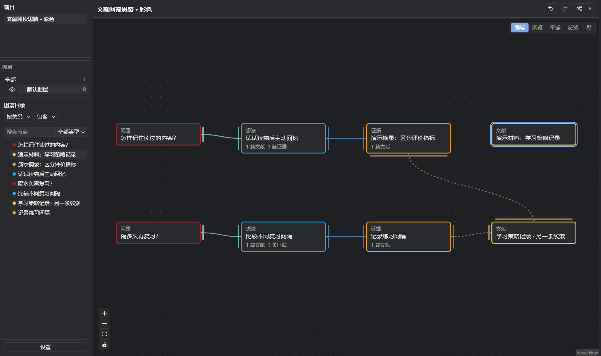
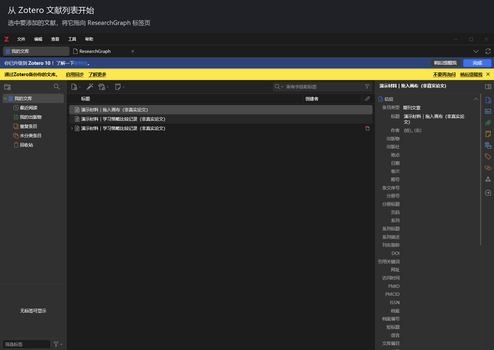

# ResearchGraph for Zotero

[中文](README.md) · English · [Download](https://github.com/liuuang/researchgraph-releases/releases/latest)

**Keep your research thinking connected, so you and AI can pick up where you left off.**

Research is hard to record as a whole. Ideas end up in scattered notes, excerpts stay in PDFs, and organizing everything by hand interrupts reading. AI can find papers, but the connection between each piece of evidence and your question often gets lost. Start a new conversation, and you have to piece the context together again.

ResearchGraph is a visual research graph inside Zotero. You and AI can record questions, ideas, actions and evidence in the same graph, keeping both your reasoning and your next steps in view.

| Read it. Forgot it. Read it again. | GPT and Claude are deep in discussion. Me: caveman. |
| --- | --- |
|  |  |

*Give the thinking a home beyond your memory and chat history. Meme sources: [rereading](https://ch.pinterest.com/pin/rereading-the-same-paragraph--48695239713266990/) · [AI and the caveman](https://www.woshipm.com/ai/6444972.html).*

Use the button beside grid snap to show or hide selected relationship edges. Its dropdown lets you choose which relationships to hide. This works independently of plugins. Directory ordering handles the directory; its plugin page no longer contains the hierarchy relation dropdown.

When creating an evidence card, enter a name or leave it blank to use the selected text or paper title. Source text and the cited paper stay separate; add your notes in Description.

Automatic updates are enabled by default in the version maintenance settings. You can turn them off and still check for updates manually.

## How it works

Start with a question. Add an idea, then connect the evidence, counterarguments, conditions and actions around it. Build the graph gradually as you read and discuss.

**Evidence keeps the original passage; relationships explain how it connects to your question.** A relevant paper does not necessarily support a claim. Recording where it fits and why it matters makes your reasoning easier to revisit, for both you and AI.

## What you can do

- **Record and examine ideas**: connect nodes with support, contradiction and conditions to inspect the reasoning behind a claim.
- **Stay close to the literature**: drag papers from Zotero, create evidence from PDF selections or annotations, preview pages and return to the source.
- **Work with AI**: connect a compatible client through optional MCP tools to read your graph and add ideas and evidence. A new conversation can reload the graph; the plugin does not automatically remember every chat.
- **Organize in layers**: organize research angles into layers; copy and paste across layers to share the same node. Switch between Edit, Read, Tile, and Overview, and control layer visibility from the sidebar. Edit and Read share the same cards, viewport, and selection; Tile stays aligned with the active layer.
- **Keep revising**: focused reading, automatic layout, undo/redo, version comparison and restoration, and project JSON import/export.

## Get started

ResearchGraph is in development and targets **Zotero 10**.

1. [Download the latest XPI](https://github.com/liuuang/researchgraph-releases/releases/latest).
2. In Zotero, open **Tools → Plugins**, click the gear, and choose **Install Plugin From File…**.
3. Restart if prompted, then choose **Tools → Open ResearchGraph**.

Begin with one question and one idea. Connect them, then add evidence or an action.

The interface follows Zotero's language by default: Chinese locales use Simplified Chinese; other locales use English. Override it in **Settings → Advanced → Interface style → Interface language**. Default type and relation names follow the selection; custom names and research content stay unchanged.

Graphs are stored in a separate local database. AI requires a separately configured MCP client. You remain responsible for checking evidence and AI edits.

---

This repository provides the public introduction and installable releases. The source repository is currently private. Screenshots and animations use demo data, not real research findings. ResearchGraph is an independent project and is not affiliated with Zotero.

Node edges are controlled in Settings → Appearance → Nodes → Node edge style. Colored edges are the default. [Monochrome example](assets/share/mono-pdf-00.png).

## Recent changes

- Clicking a layer shows only that layer; All shows every layer, and eye icons reflect actual visibility.
- Paste at the pointer position; Ctrl+X moves nodes between layers after a successful paste. Escape cancels the cut.
- Both edit and read modes use left-drag for box selection and Ctrl+left-drag for panning.
