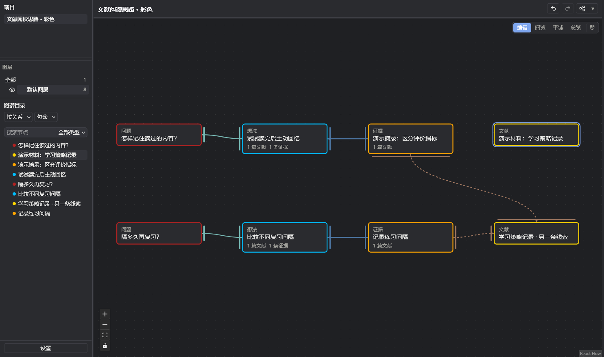
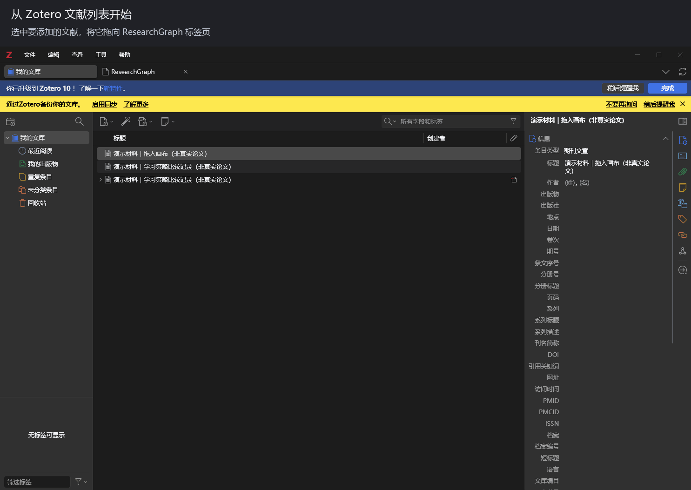

# ResearchGraph for Zotero

[中文](README.md) · English · [Download](https://github.com/liuuang/researchgraph-releases/releases/latest)

**Keep your research thinking connected, so you and AI can pick up where you left off.**

Research is hard to record as a whole. Ideas end up in scattered notes, excerpts stay in PDFs, and organizing everything by hand interrupts reading. AI can find papers, but the connection between each piece of evidence and your question often gets lost. Start a new conversation, and you have to piece the context together again.

ResearchGraph is a visual research graph inside Zotero. You and AI can record questions, ideas, actions and evidence in the same graph, keeping both your reasoning and your next steps in view.

| Read it. Forgot it. Read it again. | GPT and Claude are deep in discussion. Me: caveman. |
| --- | --- |
|  |  |

*Give the thinking a home beyond your memory and chat history. Meme sources: [rereading](https://ch.pinterest.com/pin/rereading-the-same-paragraph--48695239713266990/) · [AI and the caveman](https://www.woshipm.com/ai/6444972.html).*

Use the button beside grid snap to show or hide selected relationship edges. Its dropdown lets you choose which relationships to hide. This works independently of plugins. Directory ordering handles the directory; its plugin page no longer contains the hierarchy relation dropdown.

When creating an evidence card, enter a name or leave it blank to use the selected text or paper title. Source text and the cited paper stay separate; add your notes in Description.

Automatic updates are enabled by default in the version maintenance settings. You can turn them off and still check for updates manually.

When adding evidence, target and relation default to None. Selecting a node beforehand or dropping onto a node prefills the target. A connection is created only when both target and relation are selected.

The source issue banner includes View and repair, listing broken sources and repair actions across the project without requiring a node selection.

Automatic update preferences persist across versions. Directory selections support batch context-menu actions. Node details show all sources by default with add, rebind and unlink controls. Removing a shared source node clears its current-layer associations and supports undo.

The first edge context-menu item toggles fixed and free connection sides. Fixed mode preserves the connection sides; free mode selects them as nodes move. New connections default to free mode.

New nodes select the default title for immediate replacement. Renaming places the cursor at the end of the title.

## How it works

Start with a question. Add an idea, then connect the evidence, counterarguments, conditions and actions around it. Build the graph gradually as you read and discuss.

**Evidence keeps the original passage; relationships explain how it connects to your question.** A relevant paper does not necessarily support a claim. Recording where it fits and why it matters makes your reasoning easier to revisit, for both you and AI.

## What you can do

- **Record and examine ideas**: connect nodes with support, contradiction and conditions to inspect the reasoning behind a claim.
- **Stay close to the literature**: drag papers from Zotero, create evidence from PDF selections or annotations, preview pages and return to the source.
- **Work with AI**: connect a compatible client through optional MCP tools to read your graph and add ideas and evidence. A new conversation can reload the graph; the plugin does not automatically remember every chat.
- **Organize in layers**: organize research angles into layers; copy and paste across layers to share the same node. Switch between Edit, Read, Tile, and Overview, and control layer visibility from the sidebar. Edit and Read share the same cards, viewport, and selection; Tile stays aligned with the active layer.
- **Keep revising**: focused reading, automatic layout, undo/redo, version comparison and restoration, and project JSON import/export.

## Get started

ResearchGraph is in development and targets **Zotero 10**.

1. [Download the latest XPI](https://github.com/liuuang/researchgraph-releases/releases/latest).
2. In Zotero, open **Tools → Plugins**, click the gear, and choose **Install Plugin From File…**.
3. Restart if prompted, then choose **Tools → Open ResearchGraph**.

Begin with one question and one idea. Connect them, then add evidence or an action.

The interface follows Zotero's language by default: Chinese locales use Simplified Chinese; other locales use English. Override it in **Settings → Advanced → Interface style → Interface language**. Default type and relation names follow the selection; custom names and research content stay unchanged.

Graphs are stored in a separate local database. AI requires a separately configured MCP client. You remain responsible for checking evidence and AI edits.

---

This repository provides the public introduction and installable releases. The source repository is currently private. Screenshots and animations use demo data, not real research findings. ResearchGraph is an independent project and is not affiliated with Zotero.

Node edges are controlled in Settings → Appearance → Nodes → Node edge style. Colored edges are the default. [Monochrome example](assets/share/mono-pdf-00.png).

## Recent changes

- Clicking a layer shows only that layer; All shows every layer, and eye icons reflect actual visibility.
- Paste at the pointer position; Ctrl+X moves nodes between layers after a successful paste. Escape cancels the cut.
- Both edit and read modes use left-drag for box selection and Ctrl+left-drag for panning.

### v0.0.34

Quick connections with curved previews and target snapping, number-key relation selection, 2/4/8-sector right-drag menus, and neutral dark colors.

### v0.0.35

- Unified paper entry with current Zotero selection and highlighted drop targets.
- Node visibility filters and relation filters; all relations visible by default.
- Simplified relation picker and numbered node/relation submenu shortcuts.
- Coalesced connection previews and fewer redundant geometry reads and radial-menu updates.

### v0.0.36

- Built-in Quick actions plugin controls drag sorting and number shortcuts while preserving saved order.
- Number hints precede labels; reorder node and relation choices directly across menus.
- Node dragging cancels layout animation and prevents stale layout positions from overwriting live movement.

### v0.0.37

- Box-select in connection mode and connect selected nodes to one target with a single relation choice, excluding self-connections.
- Built-in Mouse gestures plugin controls the right-drag radial menu and its 2/4/8 directions.

### v0.0.38

Node and relation shortcuts retain their full-list numbers when menus omit the current item. Numbers change only when the configured order changes.

### v0.0.39

Shared-trunk context menus apply relation changes, direction reversal, fixed/free endpoints and deletion to the entire group. The menu shows the affected count; individual branches remain independent.

### v0.0.40

Includes the grouped trunk actions from v0.0.39. With Quick actions enabled, type and relation menus retain the current choice. Selecting an unchanged choice performs no mutation.

### v0.0.41

- Serialize position saves and wait for pending writes before undo, reducing stale positions and node-creation focus races.
- Optimize edge obstacle routing and synchronize selection across the directory, canvas, details and layers.
- Fix existing-paper drops across layers and clarify the actual direction of reference connections.
- Add delayed transitions and immediate response options under edge appearance. The default waits 150ms before a 280ms transition, with attachment points sliding along node borders.

Validation includes 525 unit tests, type checking, production build, localization checks and 6/6 edge-response checks. An earlier integrated run recorded 147 passes and 20 failures. Some passed subsequent targeted checks; remaining layer-transition, source-entry and focus cases are still tracked. Dense graphs may remain slow, and large-graph performance has not been remeasured after the attachment-point transitions.

### v0.0.42

- Reroute relationship lines when an unconnected node blocks them during a held drag, and restore the path when the obstacle moves away.
- Apply the same 150ms delay and 280ms transition to direct, detour and obstacle-routing mode changes, including after release.
- Standardize Chinese UI terminology for relationship lines.

544 unit tests, type checking, production build and localization checks passed, with 3/3 targeted Zotero checks. Large-graph performance has not been remeasured for these changes; previously documented integrated-test issues remain under investigation.
