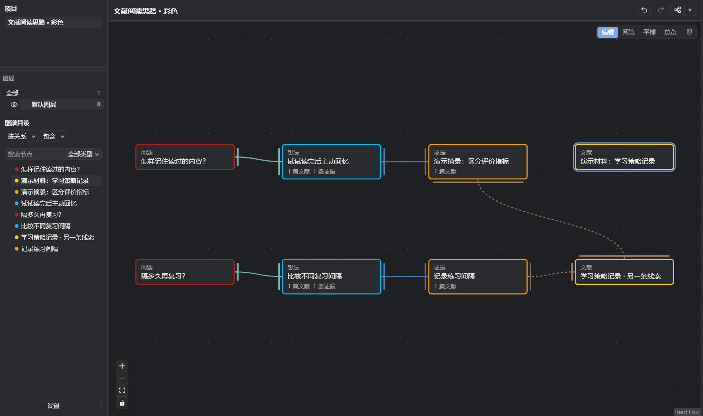
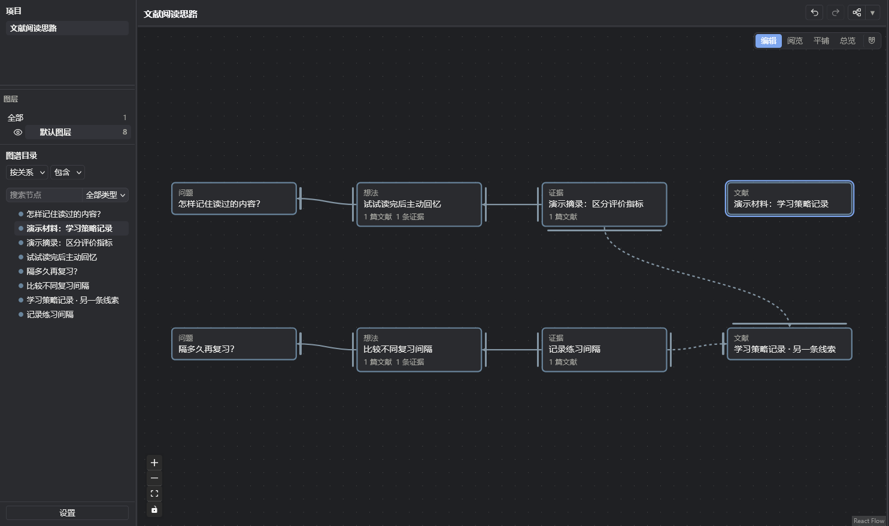
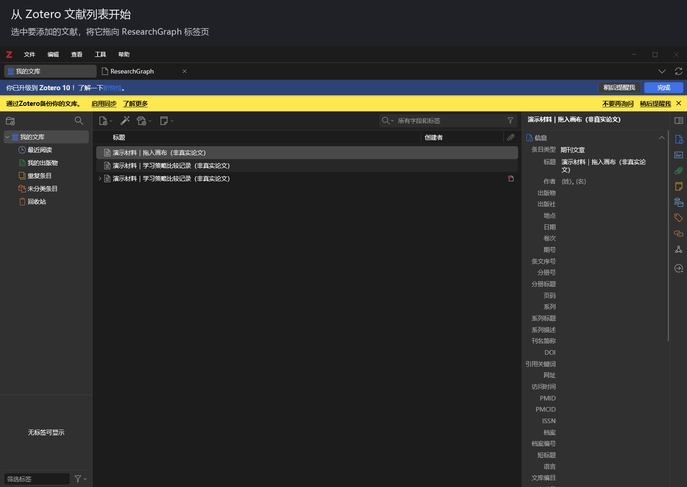

# ResearchGraph for Zotero

中文 · [English](README.en.md) · [下载](https://github.com/liuuang/researchgraph-releases/releases/latest)

**让研究思路留下来，让自己和 AI 都能接着往下想。**

研究思路很难完整记录：想法散在笔记里，摘录留在 PDF 中，手动整理繁琐，回看文献又要来回切换。AI 检索完论文，也容易忘记每条证据论证了什么，甚至与当前困惑不搭边；换个对话，上下文又散了。

ResearchGraph 是 Zotero 中的可视化研究图谱。你和 AI 可以在同一张图里记录问题、想法、行动与文献证据，把“为什么这样想”和“下一步做什么”一起留下。

| 读完了，但没记住 | AI 讨论得很明白，我还没跟上 |
| --- | --- |
|  |  |

*所以，别只把研究留在脑子和聊天记录里。梗图转载出处：[反复阅读](https://ch.pinterest.com/pin/rereading-the-same-paragraph--48695239713266990/) · [AI 与原始人](https://www.woshipm.com/ai/6444972.html)。*

磁吸按钮右侧可切换关系线显隐；旁边的小箭头可勾选要隐藏的关系。此功能独立于插件开关。“目录排序”负责目录排列，插件页不再显示层级关系下拉框。

创建证据卡时可自填名称；留空则使用选中的原文或文献标题。原文与引用文献独立保留，补充内容统一填写在“说明”中。

设置的版本维护区提供“自动更新”，默认开启；取消勾选后仍可手动检查更新。

添加证据时，目标节点和关系默认均为“无”。提前选中节点或拖到节点上释放会预填目标；只有目标和关系都选好才建立连接。

来源失效提示旁提供“查看并修复”，可直接查看整个项目的失效来源、原因和修复操作，无需先选中具体节点。

## 怎样组织思路

从一个问题开始，记录自己的想法，再连接依据、反例、适用条件和下一步行动。图不必一次画完，可以随着阅读和讨论不断补充。

**证据保存原文，关系表达它与当前问题的联系。** 找到一篇相关论文，不等于它支持某个判断；把它用在哪里、为什么有用写清楚，才方便回头检查，也方便 AI 接着工作。

查看简洁单色版

节点边缘统一在「设置 → 外观 → 节点 → 节点边缘样式」调整，默认使用彩色边缘。

## 能做什么

- **记录与辨析**：用节点保存思路，用支持、反驳、条件等关系连接，查看一个判断背后的材料与分歧。
- **连接文献**：从 Zotero 拖入文献，从 PDF 选区或标注创建证据；悬停预览页面，回到原文核对。
- **与 AI 共用**：通过可选 MCP 接入兼容客户端，让 AI 读取已有思路、补充节点和证据。新对话连接同一图谱后，可以重新读取上下文；不会自动记住所有聊天。
- **分层查看**：按研究角度组织图层，跨图层复制粘贴即可穿透同一节点；在编辑、阅览、平铺、总览之间切换，用左侧列表控制图层显隐。编辑和阅览共用卡片、视图位置和选择；平铺对齐当前主图层。
- **持续修改**：聚焦阅览、自动排版、撤销重做、版本比较与恢复，以及项目 JSON 导入导出。

## 最近更新

- 单击图层只显示该层，点“全部”显示所有图层；眼睛图标同步实际显示状态。
- 复制、粘贴落在鼠标位置；支持 Ctrl+X 剪切并跨层移动，Esc 取消剪切。
- 编辑与阅览统一为左键框选、Ctrl + 左键平移。

## 开始使用

当前为开发版，面向 **Zotero 10**。

1. [下载最新 XPI](https://github.com/liuuang/researchgraph-releases/releases/latest)。
2. 在 Zotero「工具 → 插件」中，点击齿轮，选择「从文件安装插件」。
3. 按提示重启，从「工具 → 打开 ResearchGraph」进入。

先写一个问题、一个想法，连起来，再补一条证据或一项行动。

界面默认跟随 Zotero 语言，也可在「设置 → 高级 → 界面风格 → 界面语言」选择简体中文或 English。默认类型与关系名称随之切换，自定义名称和研究内容保持原样。

图谱保存在本机独立数据库中。AI 需另行配置 MCP 客户端，证据及 AI 的整理结果仍由你核查。

---

此仓库提供公开介绍与安装包，源码仓库目前为私有。截图、动图使用演示数据，不代表真实研究结论。ResearchGraph 是独立项目，与 Zotero 官方无隶属关系。
