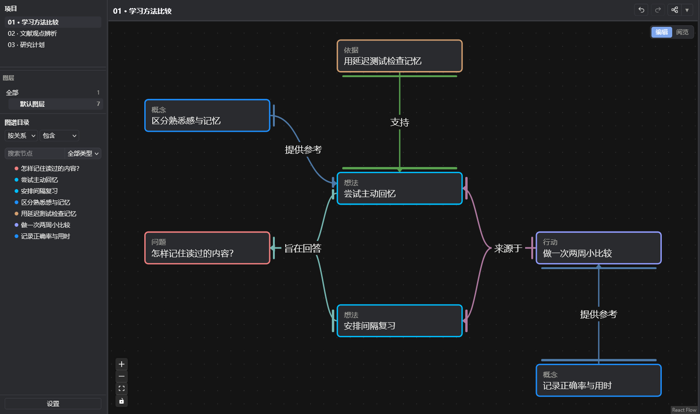
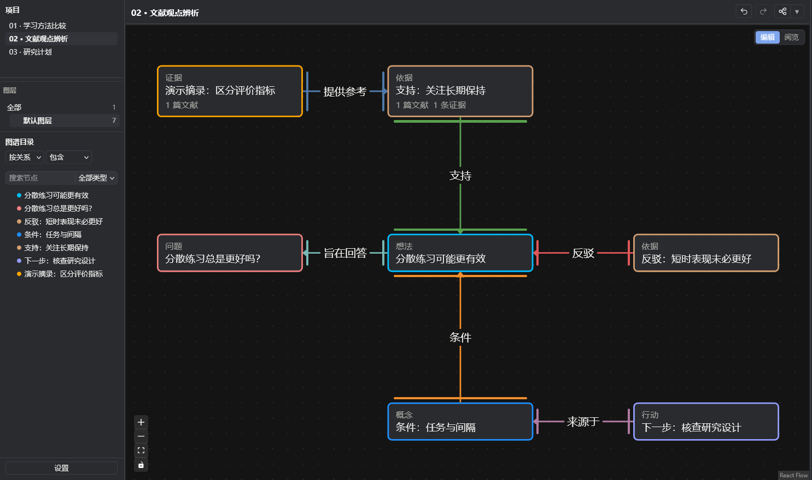
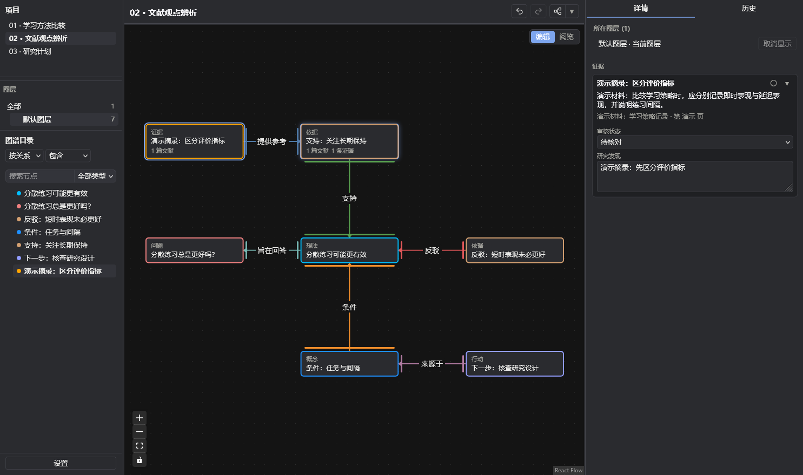
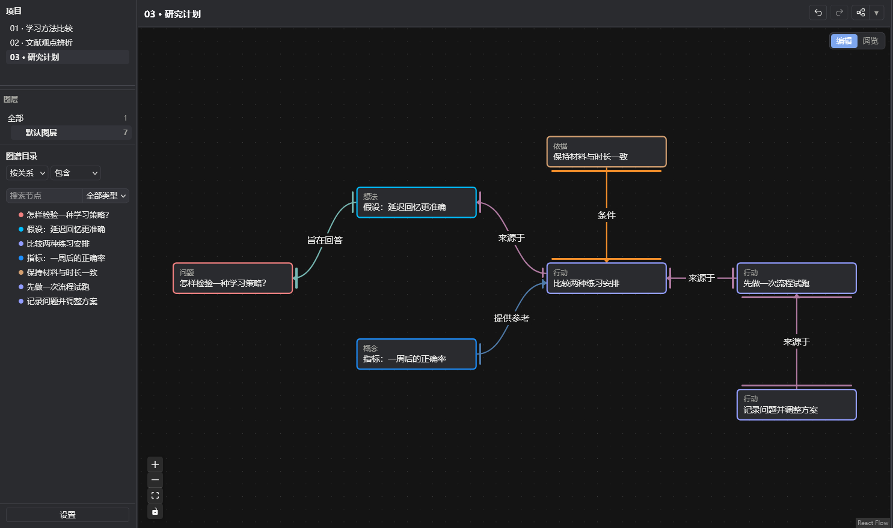
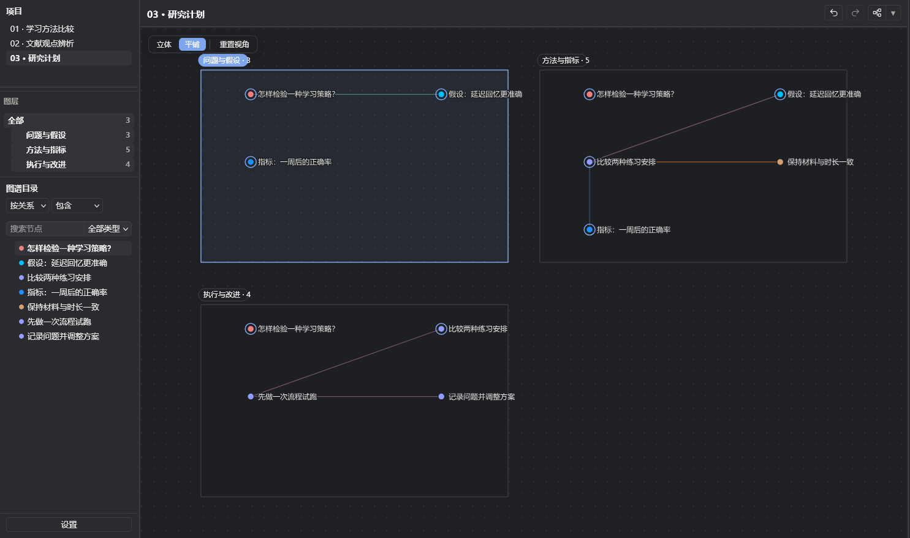
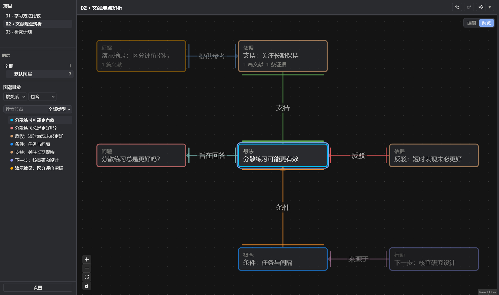
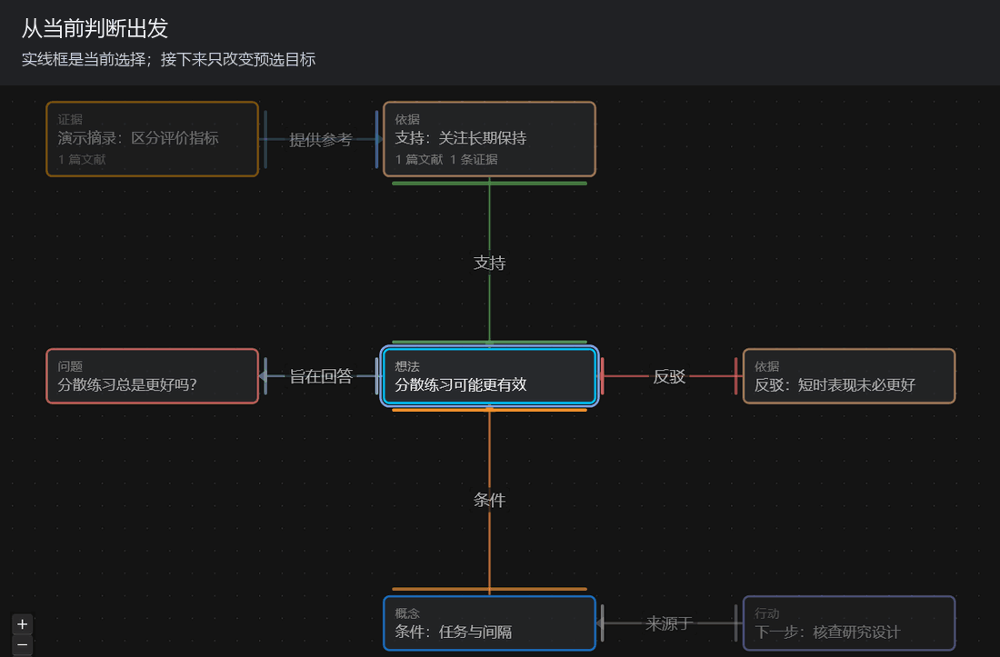

# ResearchGraph for Zotero

**把问题、想法、行动与文献依据放在一张图里，让研究思路看得见，也查得回去。**

ResearchGraph 是运行在 Zotero 标签页中的研究图谱插件。读文献时，你可以把暂时的判断、支持它的材料、反例和下一步行动连起来；回头检查时，也能知道每一条关系为什么成立。

[下载最新版 XPI](https://github.com/liuuang/researchgraph-releases/releases/latest) · [安装方法](#安装与首次使用) · [键盘阅览演示](#按住预选松开移动)

*真实插件界面，夜间模式。以下三个案例均为演示数据；其中的假设、论证与摘录不代表真实研究结论。点击图片可查看原图。*

## 从三个小例子开始

### 1. 整理一个问题：学习方法比较

“怎样记住读过的内容？”可以先拆成两个想法：主动回忆、间隔复习。然后分别补上评价标准和验证行动，而不是把所有内容都写进一条长笔记。

上图中，**问题**说明要回答什么，**想法**保留待检验的判断，**依据**解释判断的理由，**概念**澄清评价指标，**行动**让思路进入下一步。

图不必很大。从一个问题、一个想法、一条依据开始就可以。

### 2. 辨析一个观点：支持与反驳放在一起

“分散练习总是更好吗？”不能只留下支持这个观点的材料。把支持、反驳、适用条件放在同一张图里，更容易看出哪些地方还需要查文献。

*不同颜色和关系文字区分支持、反驳与条件。连线有方向，论据与它所针对的判断保持明确对应。*

**材料与判断分别保存。** 证据卡保存摘录和来源信息；“依据”节点解释你怎样使用这段材料。两者关联后，检查思路时可以同时看到论证与材料。

*这张证据卡使用专门创建的演示材料，不是虚构成真实论文的研究结果。实际使用时可关联自己的 Zotero 文献，并从 PDF 标注创建证据。*

### 3. 把判断变成计划：接下来怎样验证？

一个想法可以继续连接到研究设计、观察指标、控制条件、流程试跑和方案调整。这样，尚未验证的假设与已经安排的行动不会混在一起。

同一个项目也可以按“问题与假设”“方法与指标”“执行与改进”分层组织。节点可以跨层共享；总览将不同图层展开，方便看整体结构。

*图层适合分别整理一个问题的不同视角，而不必把所有内容一直铺在同一张画布上。*

## 搭建时看全图，阅览时看当前关系

**编辑模式**用于整理节点、关系与布局；**阅览模式**会根据选中节点的关系距离渐隐其他内容，让注意力集中到当前讨论的部分。渐隐不会删除节点或关系。

对照前面的观点辨析图，下面选择的是中央的判断节点：直接相关的支持、反驳与条件仍然清晰，更远的材料与行动退到背景。

### 按住预选，松开移动

1. 点击一个节点，再按住一个方向键：虚线框显示候选，实际选择暂时不变。
2. 保持首键按住，点按它两侧的方向键，围绕出发节点逐个切换候选。
3. **松开全部方向键，直接移动到最后的候选节点，不需要再按确认。**

动图以 `↑` 为首键：点按 `→` 顺时针切换，点按 `←` 逆时针切换。每次移动结束，下一轮都以新的选中节点为起点。

- 阅览模式：候选限于当前节点直接相连的一级邻居。
- 编辑模式：候选可以是所有可见节点，不要求有连线。
- 编辑模式下，`Shift + 方向键` 可将选中节点微移 1 px。
- `Esc` 清除选择并取消当前预选；点击别处或失去焦点也会取消未提交的预选。

不播放动图也可以查看[预选关键帧](assets/keyboard-preview.png)：虚线框是候选，实线框是当前选择。

## 还有哪些能力？

| 能力 | 可以怎样使用 |
| --- | --- |
| 文献与证据 | 关联 Zotero 文献、从 PDF 标注创建证据，回看来源与摘录 |
| 节点与关系 | 调整节点类型、关系名称和颜色，用支持、反驳、条件等关系表达思路 |
| 画布与图层 | 拖动、连线、缩放、自动排版；按不同视角分层整理 |
| 历史与版本 | 撤销、重做，保存版本并比较变化，必要时恢复旧状态 |
| 导入与导出 | 导出项目 JSON，在另一套插件环境中继续使用 |
| 可选 AI / MCP | 配置兼容客户端后，让 AI 查询、创建和整理图谱，并由你检查结果 |

AI 不是打开插件就会自动运行的功能，需要另行配置支持 MCP 的客户端。插件本身可以手动使用；连接 AI 前，也应了解所用客户端如何处理你交给它的内容。

## 安装与首次使用

当前仍为开发中的插件。**发布包面向 Zotero 10**；当前插件清单的兼容范围是 `9.999` 至 `10.0.*`，不声明支持 Zotero 7、8 或普通 9.x。

1. 到 [Releases](https://github.com/liuuang/researchgraph-releases/releases/latest) 下载 `research-graph-for-zotero.xpi`。
2. 打开 Zotero → **工具 → 插件**。
3. 点击插件管理器的齿轮，选择 **Install Plugin From File… / 从文件安装插件**，选中刚下载的 XPI。
4. 如有提示，重启 Zotero。然后从 **工具 → 打开 ResearchGraph** 进入工作台。

第一次使用，先看内置示例，再建立自己的项目：写下一个问题，添加一个想法，用关系连接，再补一条依据或一项行动。上面的三个案例用于介绍功能，并非安装后自动附带的教程项目。

已经安装的用户可以通过 Zotero 插件管理器检查更新。此仓库的 `v*` 发布提供安装包，`release` 发布保存自动更新清单。

## 适合用它做什么？

适合把文献阅读、观点辨析和研究计划组织成可以持续修改的图谱，尤其适合反复追问：“这个判断来自哪里？有什么反例？下一步怎样验证？”

它帮助你组织思路和来源关联，不会替你完成证据质量评价，也不会因为画出连线就让某个判断成为事实。图谱、摘录与 AI 建议仍需要你核查。

---

本仓库提供公开介绍与发布包。源码仓库目前为私有。截图与动图均由真实插件中的演示数据生成，不包含个人文库内容。
